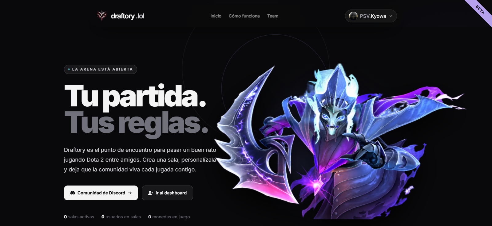

<h1 align="center">Draftory</h1>

<p align="center"><em>A full-stack community platform for custom Dota 2 matches.</em></p>

<p align="center">
  
  
  
  
  
  
</p>

<p align="center">
  <a href="https://draftory.lol/"><strong>Visit Draftory</strong></a>
</p>

<p align="center">
  <a href="https://draftory.lol/">
    
  </a>
</p>

## 〢 💭 What is Draftory?

Draftory gives Dota 2 communities a place to organize custom matches. Players can gather in a room, form Radiant and Dire teams, and follow their results over time.

`Draftory-Web` contains the web application and its server-side modules. A local demo uses sample data so you can explore the interface without service credentials.

## 〢 ✨ Features

| Area | What the web app implements |
| --- | --- |
| Accounts | Steam OpenID sign-in, player onboarding, profiles, and preferred roles |
| Match coordination | Room discovery, team assignment, captain selection, and ready checks |
| Player progression | Match history, statistics, rankings, and Elo and XP tracking |
| Community | Clans, events, and layouts for desktop and mobile |

Steam sign-in and persistent accounts require a configured backend. Live match creation and launch are outside the scope of this edition.

## 〢 🖥️ Preview

Explore the responsive landing page on [draftory.lol](https://draftory.lol/), or run the local demo below to see the interface with sample data.

The screenshot above shows the Draftory web interface.

## 〢 🛠️ Tech Stack

- **Interface:** Next.js 16.4.6 (App Router), React 19.2.8, TypeScript 5.9.3, and Tailwind CSS 4.3.3.
- **Data:** Prisma 7.10.1 and PostgreSQL.
- **Hosted app:** Vercel and Neon, with Steam OpenID for sign-in.

## 〢 📁 Project Structure

```text
Draftory-Web/
├── src/app/           Pages and web API routes
├── src/components/    Reusable interface components
├── src/lib/           Authentication, room logic, and data access
├── apps/dota-worker/  Web-facing queue, lobby, and availability modules
├── prisma/            Data model and Prisma schema
├── public/            Interface assets
└── imgr/              README preview image
```

See [the shared modules README](apps/dota-worker/README.md) for the boundary between the web app and match automation.

## 〢 ⚙️ Configuration

Keep `APP_URL` in sync with your local origin. The example configuration enables the development demo and keeps background jobs disabled. Leave `DATABASE_URL` and `DIRECT_URL` unset.

The deployment's database migration chain, private integrations, and live worker setup are outside this edition. The Prisma schema is included for reading and client generation.

## 〢 🚀 Getting Started

Use Node.js 24 and npm. From the repository root, copy the environment example by running `cp .env.example .env` on macOS or Linux, or `Copy-Item .env.example .env` in PowerShell. Then run:

```bash
npm ci
npm run db:generate
npm run dev
```

Open `http://localhost:3000/` for the landing page or `http://localhost:3000/demo` to explore sample data. Generating the Prisma client does not run migrations.

## 〢 🌐 Live Website

[**draftory.lol**](https://draftory.lol/)

## 〢 📜 Disclaimer

Draftory is an independent community project and is not affiliated with or endorsed by Valve. Dota 2 and related game artwork and marks belong to Valve or their respective rights holders. Attribution does not grant permission to reuse third-party assets.

## 〢 📄 License

Draftory does not have a project-wide open-source license. See the [third-party notices](THIRD-PARTY-NOTICES.txt) and [OpenDota's MIT notice](public/match-studio/OPENDOTA-LICENSE.txt) for the applicable materials. Those notices do not grant rights to Valve artwork or third-party trademarks.

## 〢 💜 Credits

Built by [wintercraxker](https://github.com/wintercraxker). Thanks to the maintainers of Next.js, React, TypeScript, Tailwind CSS, Prisma, and PostgreSQL, and to the Dota 2 community.

<div align="center"><strong>DRAFTORY</strong> · Built for the people you play with.</div>
:)
